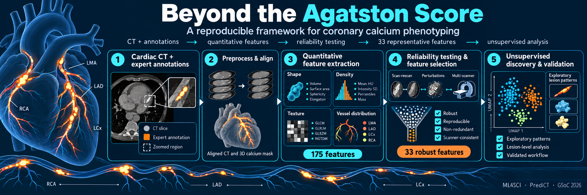
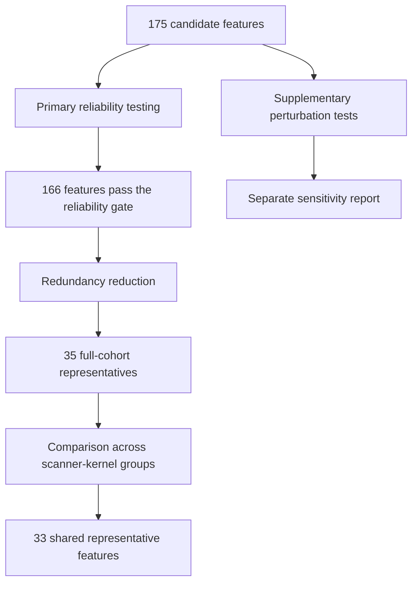
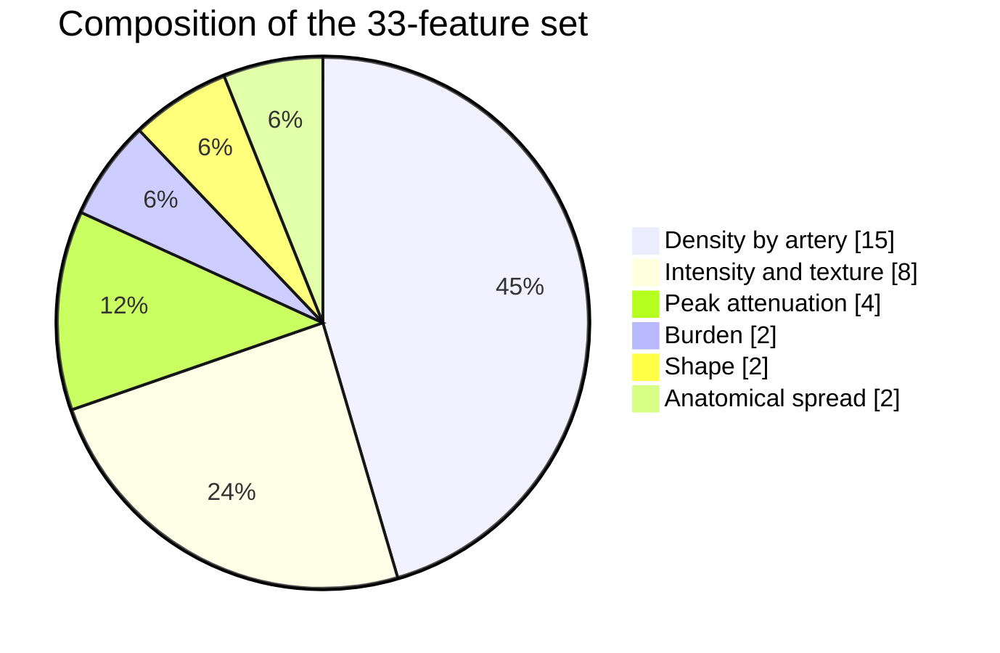
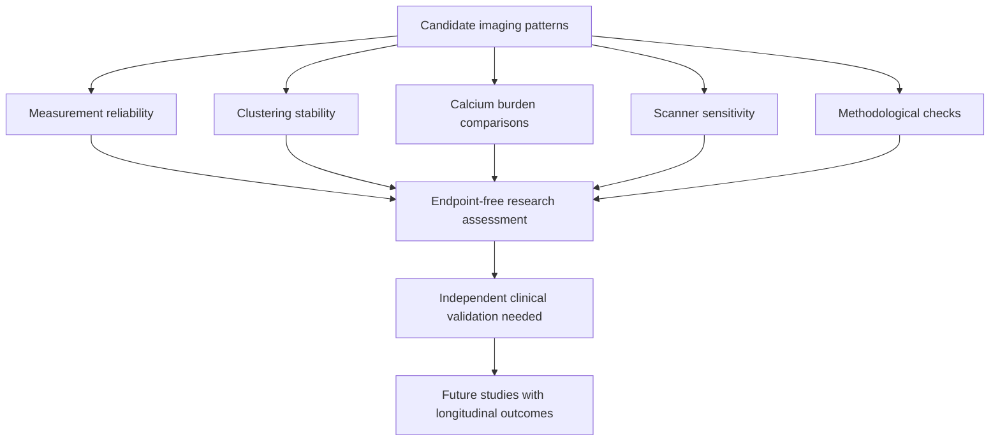
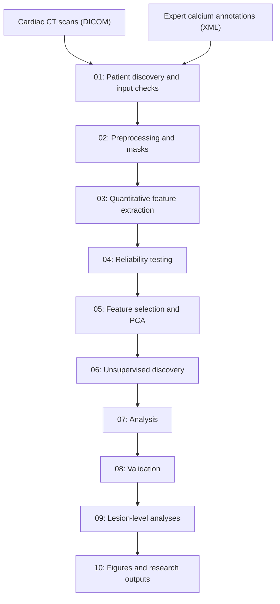

<p align="center">
  
</p>

## Radiomics Feature Extraction and Calcium Phenotype Discovery

A reproducible framework for measuring coronary artery calcium (CAC) beyond a single
score. This **Google Summer of Code 2026** project was developed within **ML4SCI's
PrediCT research initiative**, using the Stanford COCA dataset of gated, non-contrast
cardiac CT scans and expert calcium annotations. The framework extracts radiomics and
anatomical features, tests measurement reliability, explores calcium patterns with
unsupervised methods, and evaluates them **without clinical outcome labels**.

The Agatston score summarises calcium burden as one number. This project asks what
calcium shape, texture, density, and spatial distribution can add to its description,
and builds the tools needed to investigate that question reproducibly. The pipeline
is a research framework, not a clinical risk model.

## Highlights

- **End-to-end analysis at cohort scale.** The pipeline processed 439 usable gated COCA
  scans and measured 175 patient-level features: 68 canonical and annotation-derived
  measurements plus 107 PyRadiomics features. It also constructs 3D masks for 3,171
  individual lesions and retains their vessel context.
- **Reliability-tested measurements.** Under a composite perturbation gate covering
  acquisition and annotation variation, 166 of 175 features meet the predefined
  ICC >= 0.75 threshold. The experiment uses 20 draws per patient. Annotation-derived
  values that cannot change under a perturbation are marked as stable by construction.
- **A focused, interpretable feature set.** Redundancy reduction retains 35 patient-level
  representatives in the full cohort; 33 are also selected in both scanner-kernel
  subgroups. The set spans burden, attenuation, density tiers, shape, texture, and
  anatomical spread.
- **An endpoint-free phenotype-analysis toolkit.** Multiple clustering methods,
  perturbation and bootstrap stability checks, burden-aware comparisons, scanner
  subgroup analyses, a held-out scanner subset, and planted-structure simulations
  support careful evaluation of candidate patterns.
- **A traceable ten-stage workflow.** Tests, configuration, per-stage documentation,
  dated decisions, and completion records make the analysis inspectable and rerunnable.

## Project goals and what was delivered

| ML4SCI goal | Delivered |
|---|---|
| Shape, intensity, texture, and spatial features with PyRadiomics and SimpleITK | 107 PyRadiomics features across seven feature families and 68 canonical features (Agatston, volume, mass, density tiers, vessel burden, lesion count, distances, diffusivity, and concentration) for 439 scans ([features](docs/modules/features.md)) |
| A robust, documented pipeline with an interpretable key feature set | 166 features pass the primary reliability gate; 35 non-redundant representatives are selected in the full cohort and 33 are shared with both scanner-kernel subgroups. Ten stages have guides in `docs/modules/` and dated methodological decisions |
| PCA "eigen features" | PCA reduces the representative feature matrix; 15 retained components explain 86% of its variance ([reduce](docs/modules/reduce.md)) |
| Unsupervised clustering | K-means, Ward hierarchical clustering, and Gaussian mixture models are evaluated in full, burden-adjusted, and spatial feature spaces, with consensus and bootstrap stability checks ([discover](docs/modules/discover.md)). DBSCAN was proposed but is not part of the final pipeline |
| Feature-space visualisation and Agatston correlation | PCA projections, Agatston stratification, burden-aware comparisons, and per-feature monotonicity analysis ([analyse](docs/modules/analyse.md)) |
| Perturbation invariance | Controlled rotations, translations, and noise tests, plus a primary composite experiment based on acquisition and annotation variation observed in COCA ([stability](docs/modules/stability.md)) |
| Comparison with literature-derived patterns | Fixed descriptive rules for soft, moderate, and dense calcium and analyses of focal versus diffuse burden, compared with unsupervised outputs without assuming that a cluster is a clinical subtype |
| Vessel territory distribution | Per-vessel features and tests of anatomical enrichment across LAD, LCx, RCA, and left main territories |
| Feature interpretation | Effect-size ranking with FDR control, scanner-subgroup checks, and separation of burden-related from other feature relationships; no classifier is trained on clusters derived from the same features |
| Validation without clinical endpoints | Reliability, clustering stability, burden stratification, scanner-subgroup replication, GE-scanner holdout, leave-k-out refitting, and planted-structure simulations |

## Measurement reliability and the 33-feature deliverable



The primary perturbation experiment tests plausible changes in positioning, image grid,
field of view, reconstruction, dose noise, HU calibration, and annotation boundaries.
It uses 20 draws per patient and a predefined ICC threshold of 0.75. **166 of 175
features pass**. The supplementary controlled experiment applies rotations,
translations, and noise while holding the mask fixed. It answers a different, more
stressful image-mask alignment question; the two experiments are reported separately.

The reliability result needs an important distinction: 20 of the 33 final features
are derived from supplied XML values that particular perturbations cannot alter.
Their stability under those perturbations holds **by construction**, not because
annotation quality was independently validated. The other 13 final features are
directly measured from the image and mask; their primary-gate ICCs range from
0.878 to 1.000.

After variance screening, scanner-kernel harmonisation of eligible radiomics
columns, and within-family Spearman redundancy reduction, 35 representatives
remain in the full patient cohort. **33 are also selected in both scanner-kernel
subgroups.** They span six predefined feature families:



| Family (count) | Representative features | What they describe |
|---|---|---|
| Burden (2) | `mass_total`, `mass_lm` | Total calcium mass and left-main calcium mass |
| Density by artery (15) | `n_rois_d1_lad`, `n_rois_d2_lad`, `n_rois_d3_lad`, `n_rois_d4_lad`; `n_rois_d1_lcx`, `n_rois_d2_lcx`, `n_rois_d3_lcx`, `n_rois_d4_lcx`; `n_rois_d1_rca`, `n_rois_d2_rca`; `n_rois_d1_lm`, `n_rois_d2_lm`, `n_rois_d3_lm`, `n_rois_d4_lm`; `has_dense_calcium` | Four maximum-HU bands per named artery, plus a flag for any annotated region above 1,000 HU. These count 2D ROIs, not distinct 3D lesions |
| Peak attenuation (4) | `max_hu_global`, `max_hu_lcx`, `max_hu_rca`, `max_hu_lm` | Highest recorded calcium attenuation overall or in a named artery |
| Shape (2) | `original_shape_Maximum3DDiameter`, `original_shape_Elongation` | Greatest 3D extent and elongation of the combined calcium mask |
| Anatomical spread (2) | `n_calcified_arteries`, `lesion_count_lm` | Number of arteries with calcium and number of 3D left-main lesions |
| Intensity and texture (8) | `original_firstorder_Kurtosis`, `original_glcm_Idn`, `original_glcm_Correlation`, `original_glrlm_RunLengthNonUniformity`, `original_glrlm_RunPercentage`, `original_glszm_ZoneVariance`, `original_ngtdm_Contrast`, `original_ngtdm_Strength` | Intensity distribution, neighbouring-voxel relationships, same-intensity runs and zones, and local texture contrast |

Here `d1` means 130 to below 200 HU, `d2` 200 to below 300 HU, `d3` 300
to below 400 HU, and `d4` at least 400 HU. LAD, LCx, RCA, and LM denote the
left anterior descending, left circumflex, right coronary, and left main arteries.
These 33 features are interpretable image descriptors, **not 33 validated risk
predictors**. The lower-dimensional patient analysis uses PCA on the selected
representatives; 15 components explain 86% of their variance.

## Research outputs

Beyond the feature table, the framework produces a documented lesion catalogue,
scanner-subgroup analyses, burden-aware patient and lesion comparisons, stability
and holdout reports, and figures generated from completed pipeline outputs. It
includes checks that distinguish reproducible measurements from the stronger
claim that a pattern is a distinct biological phenotype. Those phenotype and
clinical questions remain subjects for separate research and validation.

## Validation framework (no clinical endpoints)



| Axis | Methods |
|---|---|
| Agatston stratification | burden orthogonality (Mann-Whitney, Levene, Cliff's delta), burden tertiles, feature monotonicity, burden-matched comparisons |
| Cluster quality | Hopkins statistic, gap statistic, consensus clustering (PAC), Hennig bootstrap Jaccard |
| Reproducibility | ICC gates under two perturbation sets, lesion-cluster stability under annotation jitter, leave-k-out cross-validation |
| Scanner sensitivity | replication within each scanner-kernel subgroup and a held-out GE-scanner subset from COCA |
| Clinical alignment | soft / moderate / dense lesion classes, focal / diffuse disease, vessel-territory enrichment |
| Method checks | planted-cluster detectability and taxometric simulations; every threshold fixed in `decisions/` before the result it governs |

## Pipeline



| Stage | Purpose |
|---|---|
| 1 `io` | Patient discovery, DICOM series selection, slice-geometry checks, calcium-XML parsing |
| 2 `preprocess` | ROI-to-slice matching by Z coordinate, 3D mask rasterisation, resampling to 0.375 x 0.375 x 3.0 mm, XML round-trip check |
| 3 `features` | Agatston scoring, 3D lesion grouping, per-vessel and spatial features, density tiers, PyRadiomics |
| 4 `stability` | Realistic (primary) and fixed-mask (supplementary) perturbation gates; robust feature set per arm and final |
| 5 `reduce` | Variance filter, ComBat kernel harmonisation, Spearman redundancy clustering, PCA |
| 6 `discover` | Hopkins, gap statistic, consensus clustering, Hennig stability, kernel association |
| 7 `analyse` | Cluster characterisation, burden orthogonality, pre-registered hypotheses, cross-cohort consistency |
| 8 `validate` | Held-out GE-scanner subset, leave-k-out cross-validation, cross-cohort ARI |
| 9 lesions | Pre-registered lesion-level analyses in `experiments/` |
| 10 figures | Six main and five supplementary figures from the published outputs |

Every stage writes to a temporary folder and publishes it in one step with a completion
record (input hashes, code fingerprint, output hashes). Each consumer verifies that record,
so a partial or stale result is never used.

## Repository layout

```
configs/      YAML configuration (paths, seeds, thresholds, perturbations)
params.yaml   PyRadiomics extraction settings
src/predict/  Library code, one subpackage per stage
scripts/      Stage scripts (numbered) and the diagnostic / probe scripts cited by the decisions
tests/        pytest suite mirroring src/predict/
experiments/  Lesion-level study plans, analysis scripts, tests, and reports
decisions/    Design-decision registry, one dated record per decision
docs/         Per-stage documentation, cohort and dataset reports, reproducibility notes
```

## Data

This repository does **not** redistribute patient CT scans or annotations. The Stanford
COCA dataset is available from the Stanford AIMI shared datasets. Place the DICOM series and
calcium XML annotations at the paths in `configs/default.yaml` (`data/raw/`,
`data/calcium_xml/`). Cohort details and exclusions: [docs/data.md](docs/data.md).

## Getting started

```bash
# Python 3.8, conda recommended
conda install -c radiomics -c conda-forge pyradiomics
pip install -r requirements.txt
pip install -e .

pytest tests/                                  # unit and integration tests
pytest experiments --import-mode=importlib     # experiment tests
bash run_pipeline.sh                           # stages 1-10 (requires the dataset)
bash run_pipeline.sh --from 6                  # rerun from stage 6
```

Worker count comes from `PREDICT_N_JOBS` or the scheduler's CPU allocation (`PBS_NCPUS`,
`NCPUS`, `SLURM_CPUS_ON_NODE`); `submit_pipeline.sh` is a PBS Pro wrapper. Every stochastic
step is seeded, and parallel results do not depend on the number of workers.

## Limitations and next steps

- COCA has no outcome data, so none of these features or exploratory patterns is validated
  against MACE. A cohort with follow-up is needed to test whether the measurements add
  prognostic value beyond Agatston scoring.
- An independent cohort is needed to assess how well the feature set and candidate
  patterns transfer across populations and acquisition settings. Some burden-matched
  lesion comparisons also require more cases.
- Not yet included: t-SNE / UMAP views, DBSCAN, and model-based feature attribution (random
  forest, SHAP); effect sizes with FDR control are used instead, which avoids training a
  classifier on labels derived from the same features.
- Position within a vessel uses height in the scan as a proxy, not a centreline.

## License

MIT, see [LICENSE](LICENSE).
